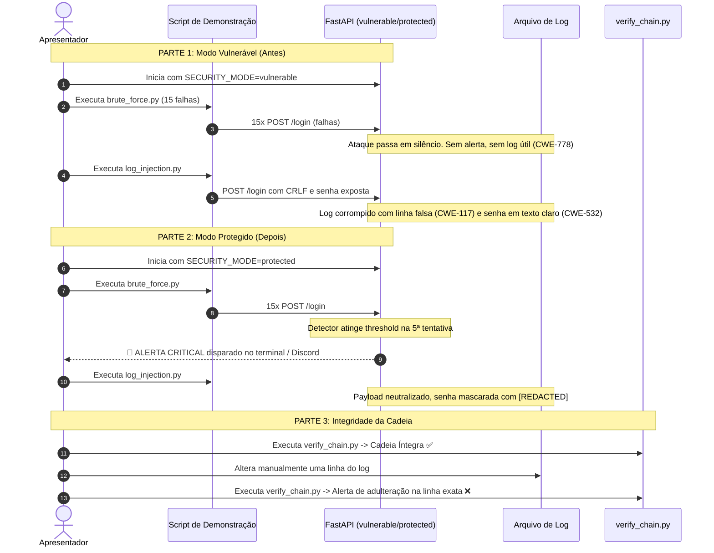

# Plano de Implementação: Mecanismo de Defesa OWASP A09 (FastAPI)

Este plano detalha a implementação prática das **Ideias 1, 2 e 3** baseadas na fundamentação teórica do artigo de OWASP A09, utilizando **Python + FastAPI**, com alternância de comportamento via `SECURITY_MODE` (`vulnerable` vs `protected`).

---

## 1. Goal Description

O objetivo é fornecer um protótipo didático e funcional demonstrando as defesas essenciais contra falhas de registro, monitoramento e alerta (OWASP A09 / CWE-778, CWE-117, CWE-532 e integridade de auditoria):

1. **Ideia 1 - Detector de Força Bruta com Alerta (`CWE-778`)**:
   - Registro estruturado em JSON com timestamp, IP de origem, usuário, rota e status (`SUCCESS` / `FAILED`).
   - Monitoramento em tempo real com contador de janela deslizante (ex: 5 falhas em 1 minuto).
   - Emissão de alerta imediato com severidade `CRITICAL` (no terminal formatado e suporte configurável a Webhook Discord).

2. **Ideia 2 - Proteção contra Log Injection e Vazamento de Dados (`CWE-117` e `CWE-532`)**:
   - Neutralização de caracteres de controle (`\r`, `\n`, escape CRLF) para impedir forja de linhas de log (*log forging*).
   - Mascaramento obrigatório de credenciais e campos sensíveis (`password`, `token`, `secret` -> `[REDACTED]`).

3. **Ideia 3 - Integridade de Logs via Cadeia de Hashes (Audit Trail Integrity)**:
   - Cada linha gravada calcula e armazena:
     $$\text{hash}_i = \text{SHA256}(\text{hash}_{i-1} + \text{payload}_i)$$
   - Um script dedicado (`verify_chain.py`) percorre o arquivo e identifica violações de integridade, apontando a linha exata adulterada.

4. **Abordagem "Antes vs Depois"**:
   - Uma única aplicação controlada pela variável `SECURITY_MODE=vulnerable` ou `SECURITY_MODE=protected`, permitindo demonstrar a ausência de defesa e a efetividade do mecanismo sem duplicar código.

---

## 2. User Review Required

> [!IMPORTANT]
> **Decisões de Design para Confirmação do Usuário:**
> 1. **Canal de Notificação do Alerta**: O alerta de Força Bruta será emitido em destaque no terminal (com cores e formatação visual) e terá suporte a variável de ambiente opcional `DISCORD_WEBHOOK_URL`. Se a URL for fornecida, o alerta é enviado diretamente para o canal do Discord; caso contrário, é exibido no console.
> 2. **Base de Usuários para Teste**: Utilizaremos uma base em memória (`dict`) com senhas pré-definidas (ou com hash simulado) para manter o projeto leve, sem dependência de banco de dados ou migrações.
> 3. **Dependências**: O projeto usará `fastapi`, `uvicorn`, `httpx` e `pytest`.

---

## 3. Open Questions

- Deseja que a aplicação bloqueie temporariamente o IP atacante (ex: 429 Too Many Requests após N falhas) no modo protegido, ou prefere focar estritamente na detecção e emissão de alerta (conforme o escopo do A09: *Logging and Alerting*)?
  *(Recomendação: focar estritamente em Registro e Alerta com resposta 401 normal, destacando que a A09 é o elo de visibilidade e notificação).*

---

## 4. Proposed Changes & Architecture

### Estrutura de Arquivos Proposta

```
projeto-seguranca/
├── app/
│   ├── __init__.py
│   ├── config.py           # Configurações gerais (SECURITY_MODE, limiares, webhook)
│   ├── security_log.py     # Logger vulnerável vs. estruturado + sanitização + cadeia de hashes
│   ├── detector.py         # Detector de brute force (janela deslizante em memória) e dispatcher de alerta
│   ├── verify_chain.py     # Verificador CLI de integridade da cadeia SHA-256
│   └── main.py             # Rotas FastAPI (/login, /profile, /health) e middlewares
├── attack/
│   ├── brute_force.py      # Script de ataque que simula N requisições de login falhas
│   └── log_injection.py    # Script que envia payload CRLF e credencial para testar CWE-117 e CWE-532
├── tests/
│   ├── __init__.py
│   ├── test_security_mode.py # Testes automatizados do modo vulnerável vs protegido
│   ├── test_sanitization.py  # Testes específicos para CWE-117 e CWE-532
│   ├── test_chain.py         # Teste de integridade e detecção de adulteração da cadeia
│   └── test_detector.py      # Teste do contador de tentativas e disparo de alerta
├── requirements.txt
└── README.md                 # Guia de execução e roteiro completo da apresentação
```

---

### Componente 1: Configuração e Alternância de Modo (`app/config.py`)

#### `[NEW]` [app/config.py](file:///home/guicarramilo/git/projeto-seguranca/app/config.py)
- Lê `SECURITY_MODE` do ambiente (default: `protected`).
- Define limiares de alerta: `BRUTE_FORCE_THRESHOLD = 5` falhas em `BRUTE_FORCE_WINDOW_SECONDS = 60`.
- Configura caminhos dos arquivos de log: `logs/app.log`.

---

### Componente 2: Sistema de Logging Seguro e Cadeia de Hashes (`app/security_log.py`)

#### `[NEW]` [app/security_log.py](file:///home/guicarramilo/git/projeto-seguranca/app/security_log.py)

```python
# Esboço da lógica de sanitização e cadeia de hashes:

def sanitize_for_log(value: str) -> str:
    """Neutraliza caracteres de controle e quebras de linha (CWE-117)."""
    return value.replace("\r", "\\r").replace("\n", "\\n")

def mask_sensitive_data(payload: dict) -> dict:
    """Mascara campos confidenciais como senhas e tokens (CWE-532)."""
    sensitive_keys = {"password", "senha", "token", "secret", "authorization"}
    sanitized = {}
    for k, v in payload.items():
        if k.lower() in sensitive_keys:
            sanitized[k] = "[REDACTED]"
        else:
            sanitized[k] = sanitize_for_log(str(v)) if isinstance(v, str) else v
    return sanitized
```

- **No modo `vulnerable`**:
  - Loga em texto corrido não sanitizado: `f"Failed login for {username} with password {password}"`.
  - Permite que payloads com quebra de linha forjem novas entradas no arquivo.
  - Não mantém cadeia de hashes.
- **No modo `protected`**:
  - Loga em formato JSON estruturado (timestamp, ip, user, action, status, prev_hash, current_hash).
  - Sanitiza strings contra CRLF injection (`CWE-117`).
  - Oculta senhas e tokens (`CWE-532`).
  - Computa `current_hash = SHA256(prev_hash + json_payload)`.

---

### Componente 3: Detector de Força Bruta e Alerta (`app/detector.py`)

#### `[NEW]` [app/detector.py](file:///home/guicarramilo/git/projeto-seguranca/app/detector.py)
- Mantém lista de timestamps de falhas indexada por IP / usuário.
- Remove registros fora da janela móvel de 60 segundos.
- Se atingir o limite (ex: 5 falhas):
  - Emite log de nível `CRITICAL`: `[SECURITY ALERT] Brute Force Detected for IP X (5 failed attempts)`.
  - Envia notificação HTTP (POST) para `DISCORD_WEBHOOK_URL` se configurada.
  - No modo `vulnerable`, o detector fica desabilitado (nenhum alerta é disparado).

---

### Componente 4: Rotas da Aplicação (`app/main.py`)

#### `[NEW]` [app/main.py](file:///home/guicarramilo/git/projeto-seguranca/app/main.py)
- Endpoint `POST /login`:
  - Recebe `username` e `password`.
  - No modo `vulnerable`, usa o logger inseguro sem checagem de força bruta.
  - No modo `protected`, usa o logger seguro, atualiza a cadeia de hashes e invoca o detector.
- Endpoint `GET /profile`:
  - Endpoint autenticado demonstrando autorização e logs de acesso.
- Endpoint `GET /status`:
  - Retorna o modo atual (`vulnerable` ou `protected`) e estatísticas básicas de eventos.

---

### Componente 5: Verificador de Integridade (`app/verify_chain.py`)

#### `[NEW]` [app/verify_chain.py](file:///home/guicarramilo/git/projeto-seguranca/app/verify_chain.py)
- Utilitário CLI para executar no terminal:
  ```bash
  python -m app.verify_chain
  ```
- Percorre cada linha do arquivo de log estruturado:
  1. Verifica se `entry["prev_hash"]` bate com o `hash` da linha anterior.
  2. Recalcula `SHA256(prev_hash + payload)` e compara com `entry["current_hash"]`.
  3. Se houver divergência, aponta explicitamente:
     `❌ FALHA DE INTEGRIDADE: Linha 14 foi adulterada! Hash esperado: X, Hash encontrado: Y`.
  4. Se estiver íntegro: `✅ CADEIA DE LOGS ÍNTEGRA: 42 registros verificados sem adulteração.`

---

### Componente 6: Scripts de Ataque para Demonstração (`attack/`)

#### `[NEW]` [attack/brute_force.py](file:///home/guicarramilo/git/projeto-seguranca/attack/brute_force.py)
- Realiza 15 tentativas sequenciais de login com senha incorreta via `httpx`.
- Exibe o progresso no terminal com respostas HTTP obtidas.

#### `[NEW]` [attack/log_injection.py](file:///home/guicarramilo/git/projeto-seguranca/attack/log_injection.py)
- Envia requisição de login com usuário contendo CRLF:
  `admin\n2026-10-01 12:00:00 [INFO] User admin successfully logged in - AUTH_BYPASS`
  e senha `MinhaSenhaSecreta123`.

---

## 5. Verification Plan

### Automated Tests (`pytest`)
Executaremos os testes automatizados para garantir a estabilidade do protótipo:
```bash
pytest tests/ -v
```
Testes a implementar:
1. `tests/test_sanitization.py`: Testa payloads com `\r\n` e garante que no modo protegido o JSON permaneça válido em uma única linha e sem quebras forjadas (`CWE-117`).
2. `tests/test_cwe_532.py`: Valida que o payload de log nunca contenha senhas em texto claro (`CWE-532`).
3. `tests/test_detector.py`: Simula chamadas de falha de login e valida se o gatilho de alerta é ativado exatamente no threshold.
4. `tests/test_chain.py`: Gera linhas com hashes válidos, simula adulteração manual em uma linha intermediária e valida que o verificador acusa a violação no índice correto.

### Manual Verification & Roteiro da Apresentação (5 a 8 min)


